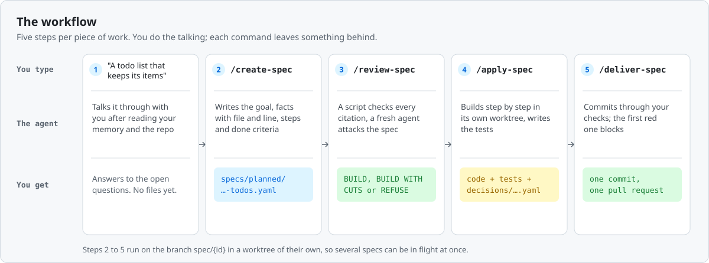
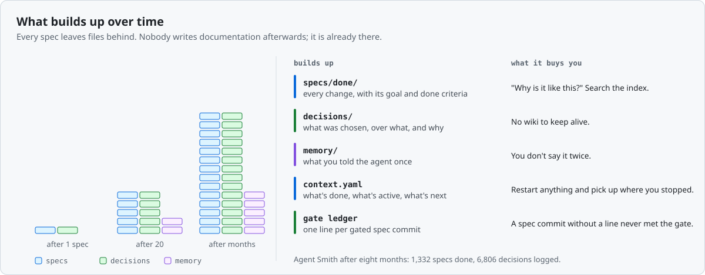

<div align="center">

<picture>
  <source media="(prefers-color-scheme: dark)" srcset="docs/assets/banner-dark.svg">
  
</picture>

### Your coding agent writes the code. This makes it write down why, too.

[](LICENSE)


[](#built-with-it-agent-smith)

[**Install**](#install) · [**Use it**](#use-it) · [**Why**](#why) · [**How it works**](#how-it-works) · [**Agent Smith**](#built-with-it-agent-smith) · [**FAQ**](#questions) · [**Website**](https://spec-first.dev)

</div>

## Contents

| Get started | Understand it | Look it up |
|---|---|---|
| [What it is](#what-it-is) | [Why](#why) | [Skills](#skills) |
| [Install](#install) | [What changes](#what-changes-when-agents-work-from-specs) | [The files](#the-files) |
| [Use it](#use-it) | [The review](#the-review-checked-before-anyone-builds-it) | [A spec](#a-spec) |
| [Without Claude Code](#without-claude-code) | [The reasoning](#the-reasoning-it-comes-along-for-free) | [Memory](#memory) |
|  | [The gate](#the-gate-nothing-lands-past-a-red-stage) | [Templates](#templates) |
|  | [A whole series](#a-whole-series-side-by-side) | [Questions](#questions) |
|  | [Agent Smith](#built-with-it-agent-smith) | [Further reading](#further-reading) |

## What it is

spec-first is a way of working with AI coding agents, and a Claude Code plugin that runs it. Before the agent writes any code, it writes a **spec**: what to build, which code it rests on, and when it's done. A second agent that never saw your conversation checks that spec against your code. Then the agent builds it on a branch of its own, and the commit only lands when your build and tests pass. Every choice it makes along the way goes into plain files in your repository.

| Checked before it's built | Built where it can't hurt | Only green lands |
|---|---|---|
| A script resolves every file and line the spec cites. A fresh agent attacks it and answers BUILD, BUILD WITH CUTS or REFUSE. | Each spec gets its own branch and worktree, so several can run side by side. | One commit per spec. A hook runs every check you declare and blocks the first red one. |

## Install

In Claude Code:

```bash
/plugin marketplace add holgerleichsenring/specification-first-agentic-development
/plugin install spec-first@specification-first-agentic-development
```

Or from a local clone:

```bash
git clone https://github.com/holgerleichsenring/specification-first-agentic-development.git
claude --plugin-dir /path/to/specification-first-agentic-development
```

Then run `/spec-first:bootstrap-project` in your repository. It reads your code and writes the setup from what it finds: the stack, the rules, and the commands that build and test it. It does not invent conventions.

Codex, Cursor, Copilot or another agent: see [Without Claude Code](#without-claude-code). The method works there too.

## Use it

<picture>
  <source media="(prefers-color-scheme: dark)" srcset="docs/assets/workflow-dark.svg">
  
</picture>

```text
You:  I want a todo list that keeps its items after a reload.
      (talk it through until nothing is open)

/spec-first:create-spec
/spec-first:review-spec
/spec-first:apply-spec
/spec-first:deliver-spec
```

That's the whole loop. A bigger change becomes a [series of specs](#a-whole-series-side-by-side) that `/spec-first:deliver-series` takes to one pull request.

## Why

An agent that writes code all day causes three problems:

- **It forgets.** Each session starts cold. What was built yesterday, and why, is gone.
- **It drifts.** Without written constraints, each session makes its own architectural calls, and they don't agree with each other.
- **Nobody kept the reason.** The diff shows what changed. Why path A beat path B was said once, in a chat window that no longer exists.

Spec-first fixes all three by making the record part of the work. The agent reads it before it starts and adds to it before it commits.

<picture>
  <source media="(prefers-color-scheme: dark)" srcset="docs/assets/over-time-dark.svg">
  
</picture>

### What changes when agents work from specs

| | |
|---|---|
| **Verified** | A fresh reviewer checks the spec against the code before the build. A gate runs your checks before the commit. |
| **Parallel** | One branch and worktree per spec. Ids come from the clock, so two agents practically never take the same one. |
| **Uninterrupted** | A reviewed spec has already answered the open questions, so the agent builds to its done criteria instead of coming back to ask. |
| **Structured** | One spec, one branch, one commit. A pull request carries one spec or a whole series, and every change has the same shape. |
| **Resumable** | State lives in `context.yaml`. Restart the machine or the agent and the work picks up where it stopped. |
| **Explained** | Each choice is logged with what it beat and why, so the reasoning stays next to the code. That one comes as a side effect. |

## How it works

### The review: checked before anyone builds it

A REFUSE costs you one spec. Without the review, the same mistake would have cost you the branch.

```text
review-spec · 2026-10-27-8a3f

  ✓ src/Host/Program.cs:40-58        resolves
  ✓ src/Config/AppConfig.cs:12-19    resolves
  evidence resolves: 1 spec

  BUILD WITH CUTS   the spec holds once two steps change
  CUT 1  Step jira needs a second auth mode the config can't hold yet.
         AppConfig.cs:15 · Move it to its own spec.
  CUT 2  Paging is missing: GitHub returns 30 issues per page.
         GitHubClient.cs:88 · Add a done criterion.
```

- **Every citation is checked.** A script opens each file and line the spec cites. A claim nobody checked in the code has to be listed as an assumption.
- **The reviewer starts fresh.** A new agent with no conversation history reads the code as it is, not as the spec says it is.
- **One verdict, with cuts named.** BUILD, BUILD WITH CUTS or REFUSE, and every finding names a file and a line.

### The reasoning: it comes along for free

Nobody has to write documentation afterwards. While it builds, the agent logs each choice that wasn't obvious: what it chose, what it chose over, and why. One file per spec, next to the code.

```yaml
# decisions/2026-10-27-8a3f.yaml
spec: 2026-10-27-8a3f
decisions:
  - category: TradeOff
    chose: "Raw HttpClient for the GitHub API"
    over: "Octokit"
    reason: "Three megabytes of dependencies for four calls."
  - category: Architecture
    chose: "One ITicketProvider per tracker"
    over: "A generic REST mapper"
    reason: "Each tracker pages and authenticates differently; the mapper would leak it."
```

`cat decisions/*.yaml` is the project's reasoning, spec by spec, in the same history as the code it explains. A memory records what git can't tell: how you want things done, a constraint outside the repo, a pointer elsewhere. One fact per file, one line in an index.

### The gate: nothing lands past a red stage

<p align="center"></p>

The plugin installs a `PreToolUse` hook on Bash. It only acts on a `git commit` whose message carries a spec id in parentheses. It resolves the real message, so `-m`, `-F <file>`, `-C <rev>` and `--amend --no-edit` are all gated. It runs the `verify:` stages from the root of the tree the commit runs in:

```yaml
verify:
  - label: build
    command: "dotnet build"
  - label: web
    command: "cd web && npm test"
    when_present: web/package.json
```

All green, it commits. The first red stage blocks it, and its output goes back to the agent. Every gated commit leaves one line in a ledger, so a spec commit without a line never met the gate. If the repository already has a gate of its own, `gate: project` in one `context.yaml` makes the plugin's gate step aside, so each commit is checked once.

### A whole series, side by side

Cut a bigger change into a series of specs. `/spec-first:deliver-series` reviews all of them, builds the groups that share no file at the same time, verifies the merged tree and opens one pull request.

```text
deliver-series 2026-10-27-5c1e          5 specs · 3 groups

  a  tickets-provider-contract   requires nothing   group 1
  b  tickets-github-provider     requires a         group 1
  c  tickets-jira-provider       requires a         group 1
  d  settings-provider-page      requires nothing   group 2
  e  ci-restore-cache            requires nothing   group 3

  3 worktrees building in parallel · every spec commit through the gate → PR #42
```

Specs that share no file are built at the same time; specs that depend on each other share a group.

## Built with it: Agent Smith

<a href="https://github.com/holgerleichsenring/agent-smith"></a>

[Agent Smith](https://github.com/holgerleichsenring/agent-smith) is an open source agentic software factory: you drop a ticket into your tracker, and a verified pull request comes back with its reasoning and its cost. It is entirely built with this method, and the method grew out of building it. Everything in this plugin ran there first; the plugin's commit gate is ported from Agent Smith's own.

| Specs done | Decisions logged | Lines of C# | Tests | Stopped by the gate |
|---|---|---|---|---|
| 1,332 | 6,806 | 743,663 | 10,944 | 1 in 6 |

Counted in the Agent Smith repository on 28 October 2026. None of the code was written by hand. The [field report](https://spec-first.dev/field-report) tells what went wrong along the way and what changed because of it.

If you'd rather not drive the loop yourself, [Agent Smith runs it for you](https://agent-smith.org): ticket in, spec derived and reviewed, built in sandboxes, verified criterion by criterion, pull request out. [`examples/agent-smith/`](examples/agent-smith/) has real artifacts from that repository: a context, specs and decision files.

---

## Without Claude Code

The method doesn't need the plugin. Codex, Cursor, Copilot and a plain terminal follow the same files. The quickest start is to paste this into any agent that can read and write your repository:

```text
Set up specification-first agentic development in this repository,
following the templates at
https://github.com/holgerleichsenring/specification-first-agentic-development/tree/main/templates

1. Create .{project}/contexts/default/context.yaml and coding-principles.md.
   Fill them from the code as it is: stack, architecture, limits, conventions,
   and the commands that build and test it as verify: stages. Invent nothing.
2. Create .{project}/specs/planned, active and done, .{project}/decisions/
   and .{project}/memory/MEMORY.md.
3. Write AGENTS.md from templates/prompt.md, with .{project}/ filled in.
4. Add "gate: git" at the top level of that context.yaml.
```

By hand, it's four steps:

1. Copy [`templates/`](templates/) into your project as `.yourproject/` and fill in `contexts/default/context.yaml`.
2. Write `AGENTS.md` at the root from [`templates/prompt.md`](templates/prompt.md). Most coding agents read it when a session starts, and Claude Code reads it through a `CLAUDE.md` that holds `@AGENTS.md`. Each step in it says how to do the step by hand.
3. Clone this repository once. It holds the evidence check (`skills/review-spec/scripts/check-evidence.py`, needs python3 and PyYAML) and the gate as a git hook.
4. Set `gate: git` in one context and run `python3 <clone>/hooks/install-git-hook.py` in each clone of your project. The commit-msg hook then runs the `verify:` stages on every commit whose message names a spec, whichever agent made it. Hooks are per clone and `git commit --no-verify` skips them, so every teammate installs it and nobody skips it on a spec commit.

---

## Reference

### Skills

| Skill | What it does |
|---|---|
| `/spec-first:bootstrap-project` | Sets up the method in a new or existing project |
| `/spec-first:create-spec` | Writes a spec and commits it on `spec/{id}` in a new worktree |
| `/spec-first:review-spec` | Runs the evidence check, then gets a fresh reviewer's verdict before any code is written |
| `/spec-first:apply-spec` | Implements the active spec up to its done criteria |
| `/spec-first:deliver-spec` | Commits through the gate, reads the verdict, pushes and opens the pull request |
| `/spec-first:deliver-series` | Takes a whole series of specs to one pull request: review, parallel builders, merged-tree verify, CI |
| `/spec-first:log-decision` | Records a design decision in the spec's decision file |
| `/spec-first:update-project` | Brings a project up to a newer plugin version, including layout migrations |
| `/spec-first:spec-first-workflow` | The method in one page, for the agent |

### The files

```
.yourproject/
  contexts/
    default/                  # one per stack; a monorepo adds server/, client/, docs/ …
      context.yaml            # stack, architecture, quality limits, verify:, state, workdir
      coding-principles.md    # rules the agent reads every session
  specs/
    planned/  active/  done/  # {id}-{label}.yaml
  decisions/
    {id}.yaml                 # every decision one spec made
  memory/
    MEMORY.md                 # index, one line per fact
    {name}.md                 # one fact per file: feedback, project or reference
  series/                     # optional manifests when a tool cuts a series from a ticket
```

### A spec

```yaml
spec: 2026-10-27-8a3f
goal: "Ticket providers so pipelines can pull work from GitHub and Jira"
applies_to: server

facts:
  - claim: "Pipelines take work only from the CLI today"
    evidence: "src/Host/Program.cs:40-58"

decisions:
  - key: "Adapter over repository: read-mostly data, no unit of work needed"

steps:
  - id: contracts
    action: "Define ITicketProvider and TicketDto in Contracts"
    new:
      - "ITicketProvider: { GetOpenAsync, GetByIdAsync }"

upgrade_impact: "nothing: providers are opt-in per project"
proven_live: "a real GitHub repo returns its open issues; done once by hand"

tests:
  - "GitHubProvider_GetOpen_ReturnsMappedTickets"

done:
  - "GitHub provider returns tickets end to end"
```

Ids are minted from the clock: today's UTC date plus four random hex digits. Two agents in two worktrees, or one with no network, practically never mint the same id. Specs cut from one piece of work share the number and add a letter (`…-5c1ea`, `…-5c1eb`). Older counter ids such as `p0042` stay valid.

### Memory

A decision records a choice. A memory records a fact the next session needs and can't get from code or git: how the operator wants things done, a constraint outside the repository, or a pointer to something external. One file per fact, one index line each. The agent reads the index and opens an entry only when a line touches its task.

### Templates

| File | Purpose |
|---|---|
| `contexts/default/context.yaml` | Per-stack metadata, architecture, quality limits, `verify:`, `gate:`, spec state |
| `contexts/default/coding-principles.md` | Per-stack rules the agent follows |
| `spec.yaml` + `spec.schema.json` | A new spec, with IDE autocompletion |
| `decisions/p0001.yaml` + `decision.schema.json` | The decision-file shape |
| `context.schema.json` | Schema for `context.yaml`: `verify:`, `gate:`, `evidence_roots:` |
| `memory/` | The memory index and the entry shape |
| `prompt.md` | The basis for `AGENTS.md`: read order and workflow for any agent, with each plugin step also described by hand |

Projects on an older layout (v1 flat files, or `phases/` before 2.5) migrate with `/spec-first:update-project`.

---

## Questions

<details>
<summary><b>What is spec-first agentic development?</b></summary>

A way of working with AI coding agents in which every change starts as a written spec in your repository. A fresh reviewer checks the spec against your code before anything is built, the agent builds it on its own branch and worktree, and the commit lands only when your checks pass.
</details>

<details>
<summary><b>What does specification-driven agentic development mean here?</b></summary>

The spec drives the work from start to finish. It names the goal, the facts it rests on with file and line, the steps and the done criteria, and the agent builds to exactly that. Spec-first agentic development is specification-driven agentic development in which the spec is reviewed against the code before the first line is written.
</details>

<details>
<summary><b>Do I need Claude Code?</b></summary>

No. The Claude Code plugin runs the steps as commands. Codex, Cursor, Copilot or a terminal follow the same files through `AGENTS.md`, and a git commit-msg hook runs the same commit gate in every clone where it is installed.
</details>

<details>
<summary><b>How does it differ from vibe coding?</b></summary>

You still describe the feature in your own words and talk it through. After that, the agent works from a reviewed spec instead of from the last prompt, logs each decision with its reason, and a commit lands only when your build and tests pass.
</details>

<details>
<summary><b>What does a spec contain?</b></summary>

A one-sentence goal, the facts it rests on with file and line, the steps, what an upgrade costs an operator, and the done criteria. The decisions made while building go into a separate YAML file next to it.
</details>

<details>
<summary><b>Isn't a spec precise enough to generate a program just code?</b></summary>

Yes, and these specs aren't that precise on purpose. A spec pins down intent and architecture: what to build, why, which code it rests on and what done means. The tests and the commit gate supply the precision.
</details>

<details>
<summary><b>Don't old specs go stale?</b></summary>

A done spec is never updated and isn't read by default. It's a change record, like a commit with its reasoning attached. Agents read the code to learn what the system does, and search the spec index when they need to know why.
</details>

<details>
<summary><b>Why YAML and not Markdown?</b></summary>

The values are still plain English. The schema keeps them short and lets a script check every cited file and line. When Agent Smith moved 93 specs from Markdown to YAML, they shrank to a fifth of their size.
</details>

<details>
<summary><b>How is a spec different from an agent's plan?</b></summary>

A plan lives in one session. A spec stays in the repository, is reviewed against the code before it's built, and its definition of done is checked when the change is committed.
</details>

<details>
<summary><b>How does it compare to Spec Kit, BMAD and GSD?</b></summary>

All of them write a spec or a plan before the code. spec-first checks the spec against the code before the build and blocks the commit while a check is red. The [comparison page](https://spec-first.dev/compare) goes through it row by row.
</details>

<details>
<summary><b>What does it cost?</b></summary>

Nothing. The method, the templates and the Claude Code plugin are MIT licensed.
</details>

## Further reading

- [1,300 specs and no hand-written code: what held up](https://spec-first.dev/field-report), field report, October 2026
- [spec-first, Spec Kit, BMAD and GSD](https://spec-first.dev/compare), comparison, October 2026
- [The Why Never Gets Written Down](https://codingsoul.org/2026/04/11/the-why-never-gets-written-down/), essay, April 2026
- [Next Level Vibe Coding](https://codingsoul.org/2026/04/21/next-level-vibe-coding/), essay, April 2026

## License

MIT. Written by Holger Leichsenring and one language model.
