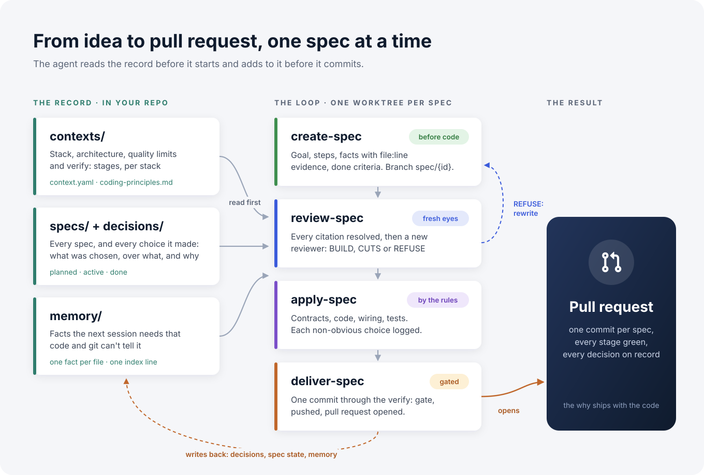
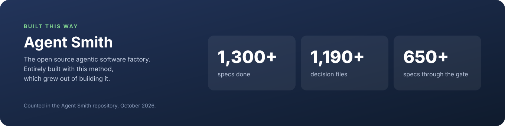
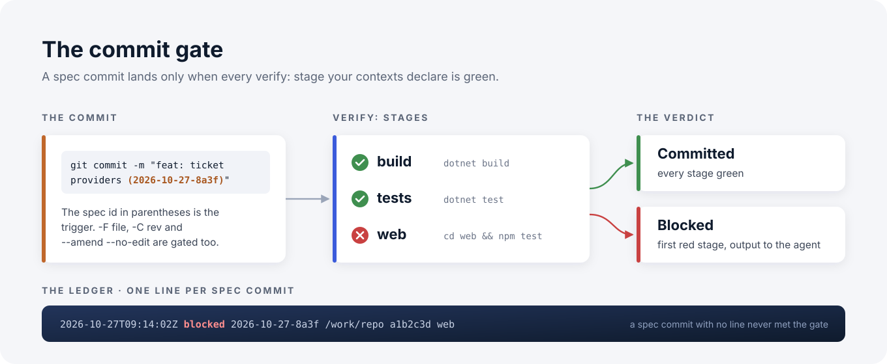

# Specification-First Agentic Development

> Your coding agent writes the code. This makes it write down why, too.

Spec-first agentic development, or specification-driven agentic development: a small set of files and habits for working with AI coding agents. Every piece of work starts as a spec, gets checked against the real code before anyone builds it, and ends as one commit and one pull request with its decisions on record. The files are YAML and Markdown and live in your repository. Any agent can follow the method. The Claude Code plugin takes care of the bookkeeping.

[](LICENSE)


**Website:** [spec-first.dev](https://spec-first.dev), spec-first agentic development explained · **Background reading:** [The Why Never Gets Written Down](https://codingsoul.org/2026/04/11/the-why-never-gets-written-down/) · [Next Level Vibe Coding](https://codingsoul.org/2026/04/21/next-level-vibe-coding/)

---

## Why

An agent that writes code all day causes three problems:

- **It forgets.** Each session starts cold. What was built yesterday, and why, is gone.
- **It drifts.** Without written constraints, each session makes its own architectural calls, and they don't agree with each other.
- **Nobody kept the reason.** The diff shows what changed. Why path A beat path B was said once, in a chat window that no longer exists.

Spec-first fixes all three by making the record part of the work. The agent reads it before it starts and adds to it before it commits.

## How it works

<p align="center"></p>

1. **The spec comes before the code.** It holds the goal, the steps, what the spec rests on (with file and line evidence), what an upgrade costs an operator, and what "done" means. No code until it exists.
2. **The spec is reviewed before anyone builds it.** A script resolves every file and line the spec cites. A fresh subagent that never saw the conversation then attacks the spec against the code as it is, and gives one verdict: BUILD, BUILD WITH CUTS or REFUSE. A REFUSE costs you a spec. Without the review, the same mistake would have cost you the branch.
3. **The build follows the rules.** The agent reads every `context.yaml` and `coding-principles.md` first. It builds in the spec's own worktree and logs each non-obvious choice: what it chose, what it chose over, and why.
4. **Delivery goes through a gate.** One commit, `feat: … ({id})`. A hook runs every `verify:` stage your contexts declare and blocks the commit on the first red one. Every gated commit leaves one line in a ledger, so a spec commit without a line never met the gate.

Restart your machine, restart the agent, open `context.yaml`, and you're back where you left off.

## Built with it

<a href="https://github.com/holgerleichsenring/agent-smith"></a>

[Agent Smith](https://github.com/holgerleichsenring/agent-smith) is an open source agentic software factory: you drop a ticket into your tracker, and a verified pull request comes back with its reasoning and its cost. Agent Smith is entirely built with this method, and the method came out of that project. Its specs, decisions and gate are the long-run test for everything in this plugin; the plugin's commit gate is ported from Agent Smith's own.

If you'd rather not drive the loop yourself, Agent Smith runs it for you: ticket in, spec derived and reviewed, built in sandboxes, verified criterion by criterion, pull request out.

[`examples/agent-smith/`](examples/agent-smith/) has real artifacts from that repository: a context, specs and decision files.

---

## Install (Claude Code)

```bash
/plugin marketplace add holgerleichsenring/specification-first-agentic-development
/plugin install spec-first@specification-first-agentic-development
```

Or from a local clone:

```bash
git clone https://github.com/holgerleichsenring/specification-first-agentic-development.git
claude --plugin-dir /path/to/specification-first-agentic-development
```

Then run `/spec-first:bootstrap-project` in your repository. It reads your code and writes the contexts, the coding principles and the agent instructions from what it finds. It does not invent conventions.

### Skills

| Skill | What it does |
|---|---|
| `/spec-first:bootstrap-project` | Sets up the method in a new or existing project |
| `/spec-first:create-spec` | Writes a spec and commits it on `spec/{id}` in a new worktree |
| `/spec-first:review-spec` | Runs the evidence check, then gets a fresh reviewer's verdict before any code is written |
| `/spec-first:apply-spec` | Implements the active spec up to its done criteria |
| `/spec-first:deliver-spec` | Commits through the gate, reads the verdict, pushes and opens the pull request |
| `/spec-first:deliver-series` | Takes a whole series of specs to one pull request: review, parallel builders, merged-tree verify, CI |
| `/spec-first:log-decision` | Records a design decision in the spec's decision file |
| `/spec-first:update-project` | Brings a project up to a newer plugin version, including layout migrations |
| `/spec-first:spec-first-workflow` | The method in one page, for the agent |

### The commit gate

<p align="center"></p>

The plugin installs a `PreToolUse` hook on Bash. It only acts on a `git commit` whose message carries a spec id in parentheses. It resolves the real message, so `-m`, `-F <file>`, `-C <rev>` and `--amend --no-edit` are all gated. It runs the `verify:` stages from the root of the tree the commit runs in:

```yaml
verify:
  - label: build
    command: "dotnet build"
  - label: web
    command: "cd web && npm test"
    when_present: web/package.json
```

If the repository already has a gate of its own, `gate: project` in one `context.yaml` makes the plugin's gate step aside, so each commit is checked once.

## Without Claude Code

The method doesn't need the plugin. Codex, Cursor, Copilot and a plain terminal follow the same files:

1. Copy [`templates/`](templates/) into your project as `.yourproject/` and fill in `contexts/default/context.yaml`.
2. Write `AGENTS.md` at the root from [`templates/prompt.md`](templates/prompt.md). Most coding agents read it when a session starts, and Claude Code reads it through a `CLAUDE.md` that holds `@AGENTS.md`. Each step in it says how to do the step by hand.
3. Clone this repository once. It holds the evidence check (`skills/review-spec/scripts/check-evidence.py`, needs python3 and PyYAML) and the gate as a git hook.
4. Set `gate: git` in one context and run `python3 <clone>/hooks/install-git-hook.py` in each clone of your project. The commit-msg hook then runs the `verify:` stages on every commit whose message names a spec, whichever agent made it. Hooks are per clone and `git commit --no-verify` skips them, so every teammate installs it and nobody skips it on a spec commit.

---

## What's in the repository

```
.yourproject/
  contexts/
    default/                  # one per stack; a monorepo adds server/, client/, docs/ …
      context.yaml            # stack, architecture, quality limits, verify:, state, workdir
      coding-principles.md    # rules the agent reads every session
  specs/
    planned/  active/  done/  # {id}-{label}.yaml
  decisions/
    {id}.yaml                 # every decision one spec made
  memory/
    MEMORY.md                 # index, one line per fact
    {name}.md                 # one fact per file: feedback, project or reference
  series/                     # optional manifests when a tool cuts a series from a ticket
```

### A spec

```yaml
spec: 2026-10-27-8a3f
goal: "Ticket providers so pipelines can pull work from GitHub and Jira"
applies_to: server

facts:
  - claim: "Pipelines take work only from the CLI today"
    evidence: "src/Host/Program.cs:40-58"

decisions:
  - key: "Adapter over repository: read-mostly data, no unit of work needed"

steps:
  - id: contracts
    action: "Define ITicketProvider and TicketDto in Contracts"
    new:
      - "ITicketProvider: { GetOpenAsync, GetByIdAsync }"

upgrade_impact: "nothing: providers are opt-in per project"
proven_live: "a real GitHub repo returns its open issues; done once by hand"

tests:
  - "GitHubProvider_GetOpen_ReturnsMappedTickets"

done:
  - "GitHub provider returns tickets end to end"
```

Ids are minted from the clock: today's UTC date plus four random hex digits. Two agents in two worktrees, or one with no network, never mint the same id. Specs cut from one piece of work share the number and add a letter (`…-8a3fa`, `…-8a3fb`). Older counter ids such as `p0042` stay valid.

### A decision

```yaml
spec: 2026-10-27-8a3f
decisions:
  - category: TradeOff
    chose: "Raw HttpClient for the GitHub API"
    over: "Octokit"
    reason: "Three megabytes of dependencies for four calls."
```

`cat decisions/*.yaml` gives you the project's reasoning, spec by spec, with no wiki to keep alive.

### Memory

A decision records a choice. A memory records a fact the next session needs and can't get from code or git: how the operator wants things done, a constraint outside the repository, or a pointer to something external. One file per fact, one index line each. The agent reads the index and opens an entry only when a line touches its task.

### Templates

| File | Purpose |
|---|---|
| `contexts/default/context.yaml` | Per-stack metadata, architecture, quality limits, `verify:`, `gate:`, spec state |
| `contexts/default/coding-principles.md` | Per-stack rules the agent follows |
| `spec.yaml` + `spec.schema.json` | A new spec, with IDE autocompletion |
| `decisions/p0001.yaml` + `decision.schema.json` | The decision-file shape |
| `context.schema.json` | Schema for `context.yaml`: `verify:`, `gate:`, `evidence_roots:` |
| `memory/` | The memory index and the entry shape |
| `prompt.md` | The basis for `AGENTS.md`: read order and workflow for any agent, with each plugin step also described by hand |

Projects on an older layout (v1 flat files, or `phases/` before 2.5) migrate with `/spec-first:update-project`.

---

## License

MIT. Written by Holger Leichsenring and one language model.
